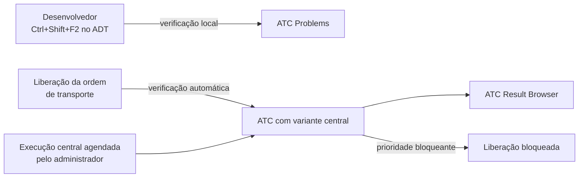

# ABAP Test Cockpit - Study

> Nível: prática
> A análise estática "oficial" do sistema SAP, para quem já usa PHPStan, Psalm ou SonarQube no PHP. Continua a verificação automática começada em [Clean-ABAP-softwarearchitecture-study](https://github.com/igor-barral/Clean-ABAP-softwarearchitecture-study), executa os testes de [ABAP-Unit-softwarearchitecture-study](https://github.com/igor-barral/ABAP-Unit-softwarearchitecture-study) e é comparada com a ferramenta fora do sistema em [abaplint-devops-study](https://github.com/igor-barral/abaplint-devops-study). A variante de *readiness* para ABAP Cloud volta em [SAP-Clean-Core-softwarearchitecture-study](https://github.com/igor-barral/SAP-Clean-Core-softwarearchitecture-study).

## Objetivo

Entender o que é o **ABAP Test Cockpit (ATC)**, como ele é configurado e como se trabalha com os achados no dia a dia: rodar no ADT, ler prioridades, corrigir ou pedir isenção. A mesma regra de negócio (total de um pedido: quantidade x preço) aparece duas vezes: uma com achados intencionais (`ZCL_IB_ATC_ORDER_TOTAL_RAW`) e outra corrigida (`ZCL_IB_ATC_ORDER_TOTAL`), para você rodar o ATC no BTP ABAP Environment trial e comparar.

Ao concluir este estudo você deverá ser capaz de responder perguntas como:

- O que é o ATC e qual a relação dele com o Code Inspector e a verificação estendida de programa?
- O que é uma variante de verificação e qual é usada por padrão no BTP ABAP Environment?
- Como rodar o ATC no ADT e o que significam as prioridades 1, 2 e 3?
- O que é uma isenção e quando faz sentido pedir uma?
- Qual a diferença entre rodar o ATC localmente e a verificação central (incluindo na liberação de transporte)?
- Como o ATC é usado para avaliar código rumo ao S/4HANA e ao ABAP Cloud?
- O que é o Code Pal for ABAP?
- ATC ou abaplint: quando usar cada um?

## Ponte

| PHP | ABAP |
|---|---|
| PHPStan / Psalm / SonarQube | ATC: executa verificações estáticas sobre objetos do sistema |
| `phpstan.neon` (nível, regras ligadas) | Variante de verificação (*check variant*): quais verificações rodam e com que parâmetros |
| `vendor/bin/phpstan analyse src/` | ADT: botão direito no objeto ou pacote > **Run As > ABAP Test Cockpit** (Ctrl+Shift+F2) |
| Erro / aviso / dica | Prioridade 1 / 2 / 3 |
| `// @phpstan-ignore-next-line` | Pragma (`##NEEDED`) ou pseudocomentário (`"#EC ...`), quando a verificação aceita |
| `phpstan-baseline.neon` aprovado no PR | Isenção (*exemption*) solicitada e aprovada por outra pessoa, registrada no sistema |
| Job de CI que bloqueia o merge | Verificação do ATC na liberação da ordem de transporte, configurada pelo administrador |
| PHPUnit rodado pelo pipeline de qualidade | Verificação ABAP Unit dentro da variante: o ATC também roda os testes |
| PHP_CodeSniffer rodando fora do servidor | abaplint, que roda fora do sistema SAP (ver [abaplint-devops-study](https://github.com/igor-barral/abaplint-devops-study)) |

A diferença principal: o PHPStan roda sobre arquivos no seu disco; o ATC roda **dentro do sistema SAP**, sobre os objetos ativos no repositório ABAP, com acesso ao dicionário, às dependências reais e aos metadados de liberação de API.

## Conteúdo

### 1. O que é o ATC

O ATC é o *framework* de verificação de qualidade do ABAP. Ele não tem verificações próprias, ele **orquestra** verificações que já existiam separadas:

| Ferramenta | O que faz | Transação no SAP GUI (on-premise) |
|---|---|---|
| Verificação estendida de programa | Avisos do compilador além da sintaxe: variável sem uso, código inalcançável, conversões suspeitas | `SLIN` |
| Code Inspector | Verificações de desempenho, segurança, robustez, convenções de nomes; variantes de verificação | `SCI` |
| ABAP Unit | Executa os testes das classes verificadas | (dentro do ATC/SCI) |
| ATC | Junta tudo, guarda resultados, isenções e configuração central | `ATC` (configuração) |

Na prática, o desenvolvedor usa o ATC pelo ADT. As transações acima existem em sistemas on-premise; no BTP ABAP Environment não há SAP GUI, e a configuração é feita por apps Fiori de administração (confira os nomes no launchpad do seu sistema).

### 2. Variantes de verificação

Uma **variante de verificação** é a lista de verificações que o ATC executa, com parâmetros. Exemplos de variantes entregues pela SAP (os nomes e a disponibilidade variam por release; confira no sistema):

| Variante | Uso |
|---|---|
| `ABAP_CLOUD_DEVELOPMENT_DEFAULT` | Padrão do BTP ABAP Environment para desenvolvimento ABAP Cloud |
| `ABAP_CLOUD_READINESS` | Avalia se código clássico já segue as regras do ABAP Cloud (uso de APIs liberadas, construções permitidas). Assunto de [SAP-Clean-Core-softwarearchitecture-study](https://github.com/igor-barral/SAP-Clean-Core-softwarearchitecture-study) |
| `S4HANA_READINESS_<release>` | Verificações de migração de código customizado de ECC para S/4HANA (objetos simplificados, tamanho de campo de material e similares) |

Em sistemas mais novos, variantes podem ser criadas como objeto de desenvolvimento no ADT; em sistemas mais antigos, pela transação `SCI` e depois associadas ao ATC na transação `ATC`. Confira no sistema qual caminho está disponível.

### 3. ATC no ADT

| Ação | Como |
|---|---|
| Rodar no objeto aberto | **Ctrl+Shift+F2**, ou botão direito > **Run As > ABAP Test Cockpit** |
| Rodar num pacote inteiro | Botão direito no pacote no *Project Explorer* > **Run As > ABAP Test Cockpit** |
| Escolher outra variante | **Run As > ABAP Test Cockpit With...** |
| Ver os achados | View **ATC Problems** (achados da última execução) e **ATC Result Browser** (histórico, incluindo execuções centrais) |
| Entender um achado | Selecione o achado: a documentação da verificação mostra o motivo e, quando existe, como suprimir |
| Pedir isenção | Botão direito no achado > **Request Exemption** |

**Prioridades:**

| Prioridade | Significado típico | Tratamento comum |
|---|---|---|
| 1 | Erro: provável defeito ou violação grave | Corrigir antes de transportar |
| 2 | Aviso: problema provável | Corrigir ou justificar com isenção |
| 3 | Informação | Avaliar; em geral não bloqueia |

A prioridade de cada verificação pode ser ajustada pelo administrador, e é a configuração central que decide quais prioridades bloqueiam a liberação de um transporte.

### 4. Os achados intencionais

[src/zcl_ib_atc_order_total_raw.clas.abap](src/zcl_ib_atc_order_total_raw.clas.abap) compila e roda, mas tem quatro problemas marcados `[ATC-n]`:

```abap
DATA lv_count TYPE i.                                       " [ATC-1]

TRY.
    LOOP AT it_items INTO ls_item.
      READ TABLE it_prices INTO ls_price WITH KEY material = ls_item-material.  " [ATC-2]
      rv_total = rv_total + ls_price-price * ls_item-quantity.                 " [ATC-3]
    ENDLOOP.
  CATCH cx_sy_arithmetic_overflow.                          " [ATC-4]
ENDTRY.
```

| # | Problema | Onde o ATC costuma apontar | Correção em `ZCL_IB_ATC_ORDER_TOTAL` |
|---|---|---|---|
| ATC-1 | Variável declarada e nunca usada | Verificação estendida de programa ("variable is not used") | Removida |
| ATC-2 | `READ TABLE ... WITH KEY` numa tabela `STANDARD` dentro de `LOOP`: busca linear a cada item | Verificações de desempenho sobre operações em tabelas internas, quando presentes na variante | Preços em tabela `HASHED` com chave única `material` |
| ATC-3 | `sy-subrc` não avaliado: se um material não tiver preço, a linha usa o **preço do item anterior**. É um defeito real, não só estilo | Verificações de robustez sobre `sy-subrc`, quando presentes na variante | Expressão de tabela; preço ausente vira `ZCX_IB_PRICE_NOT_FOUND` |
| ATC-4 | `CATCH` vazio: um estouro devolve um total parcial sem avisar ninguém | Verificações de bloco `CATCH` vazio, quando presentes na variante | Sem `TRY` desnecessário; a exceção chega a quem chamou |

O ATC-1 é o mais garantido de aparecer, porque vem da verificação estendida de programa. Os outros dependem da variante configurada no sistema, e é justamente esse o exercício: rode, anote o que apareceu e compare com a tabela. O conjunto exato de verificações da variante padrão muda entre versões; confira no sistema.

### 5. Suprimir ou isentar

Nem todo achado é para corrigir. Há três caminhos, do mais local ao mais formal:

| Caminho | Exemplo | Quando usar |
|---|---|---|
| Pragma | `DATA buffer TYPE string ##NEEDED.` | Achado do compilador ou da verificação estendida que é intencional; documentado na própria linha |
| Pseudocomentário | `"#EC CI_...` no fim da instrução | Verificações do Code Inspector que ainda usam pseudocomentário. O código exato aparece na documentação do achado |
| Isenção (*exemption*) | **Request Exemption** no ADT, com justificativa e aprovador | Quando o achado é válido em geral mas não se aplica ao caso, e a decisão precisa de registro e aprovação |

O Clean ABAP recomenda preferir pragmas a pseudocomentários quando os dois existem. Isenção tem escopo (a linha, o método, o objeto ou o pacote) e passa por aprovação de outra pessoa, o que a torna o equivalente mais próximo de um *baseline* revisado em PR.

### 6. Local, central e no transporte



- **Local:** o desenvolvedor roda quando quiser, com a variante padrão ou outra escolhida.
- **Central:** o administrador agenda execuções sobre pacotes ou componentes e publica os resultados; o desenvolvedor vê no ATC Result Browser.
- **Na liberação do transporte:** o sistema pode rodar o ATC ao liberar uma ordem e bloquear se houver achados de prioridade configurada. É o equivalente a um *status check* obrigatório no GitHub.
- **Remoto:** em cenários de migração, um sistema central (mais novo) verifica o código de sistemas mais antigos via RFC. É assim que a análise de código customizado para S/4HANA costuma ser feita. No BTP ABAP Environment existe um app de *Custom Code Migration* para esse fim; confira a disponibilidade na sua conta.

### 7. Code Pal for ABAP

O **Code Pal for ABAP** ([github.com/SAP/code-pal-for-abap](https://github.com/SAP/code-pal-for-abap)) é um projeto open source da SAP que adiciona ao ATC verificações baseadas no [Clean ABAP](https://github.com/igor-barral/Clean-ABAP-softwarearchitecture-study): número de parâmetros, tamanho de método, parâmetro booleano, `DEFAULT KEY` e outras. Em sistemas on-premise ele é instalado via abapGit. A situação do projeto (manutenção, releases suportados, versão para o BTP ABAP Environment) mudou ao longo do tempo; confira o README do repositório antes de adotar.

### 8. ATC e abaplint

| Ponto | ATC | abaplint |
|---|---|---|
| Onde roda | Dentro do sistema SAP | Fora: Node.js, Docker, CI |
| O que vê | Objetos ativos, dicionário real, dependências reais, status de liberação de APIs | Arquivos abapGit; o que não está no repositório vira *void* ou vem de `deps` |
| Executa ABAP Unit | Sim, se a variante incluir | Não |
| Precisa de sistema | Sim | Não |
| Momento típico | Antes de liberar o transporte | No *pull request*, antes de importar |
| Configuração | Variante, gerida no sistema | `abaplint.json`, versionado com o código |

Os dois se complementam. Rodando o abaplint aqui sem os `exclude` do [abaplint.json](abaplint.json), ele aponta na classe com achados:

| Regra do abaplint | Achado | Equivale a |
|---|---|---|
| `unused_variables` | `lv_count` sem uso | ATC-1 |
| `check_subrc` | `READ TABLE` sem avaliar `sy-subrc` | ATC-3 |
| `no_prefixes` | 9 ocorrências de `ty_`, `it_`, `rv_`, `ls_`, `lv_` (`tt_` não entra no padrão de tipos `^TY_`) | Regra do Clean ABAP, não um defeito |

O abaplint **não** aponta o ATC-2 (desempenho) nem o ATC-4 (`CATCH` vazio) com essa configuração. Por isso a classe com achados está excluída dessas três regras no `abaplint.json` (com as opções padrão repetidas, pela pegadinha descrita no estudo de Clean ABAP), e o repositório passa com 0 issues.

### 9. Objetos do repositório

| Objeto | Papel |
|---|---|
| `ZCL_IB_ATC_ORDER_TOTAL_RAW` | Total do pedido com achados intencionais `[ATC-n]` |
| `ZCL_IB_ATC_ORDER_TOTAL` | Mesma regra corrigida, com testes ABAP Unit |
| `ZCX_IB_PRICE_NOT_FOUND` | Exceção `CX_STATIC_CHECK` para item sem preço |

## Respostas

**O que é o ATC e qual a relação dele com o Code Inspector e a verificação estendida de programa?**
O ATC é o *framework* que executa e gerencia verificações de qualidade no sistema ABAP. As verificações em si vêm do Code Inspector (`SCI`), da verificação estendida de programa (`SLIN`), do ABAP Unit e de outras fontes; o ATC as agrupa em variantes, guarda resultados, controla isenções e se integra ao transporte.

**O que é uma variante de verificação e qual é usada por padrão no BTP ABAP Environment?**
É a configuração que diz quais verificações rodam e com quais parâmetros, parecida com o arquivo de configuração do PHPStan. No BTP ABAP Environment a variante padrão para desenvolvimento é a `ABAP_CLOUD_DEVELOPMENT_DEFAULT`; o administrador pode trocar a variante usada nas verificações centrais (confira no sistema).

**Como rodar o ATC no ADT e o que significam as prioridades 1, 2 e 3?**
Ctrl+Shift+F2 no objeto aberto, ou **Run As > ABAP Test Cockpit** num objeto ou pacote. Os achados aparecem na view ATC Problems. Prioridade 1 é erro, 2 é aviso e 3 é informação; quais delas bloqueiam o transporte é decisão da configuração central.

**O que é uma isenção e quando faz sentido pedir uma?**
É uma exceção formal a um achado, com justificativa, escopo e aprovação de outra pessoa. Faz sentido quando a verificação está certa em geral mas não se aplica ao caso, e a correção seria pior que o achado. Para avisos intencionais do compilador, um pragma na linha costuma bastar.

**Qual a diferença entre rodar o ATC localmente e a verificação central?**
A local é feita pelo desenvolvedor, quando ele quer. A central é configurada pelo administrador: execuções agendadas, uma variante comum para todos e, opcionalmente, verificação na liberação da ordem de transporte, que pode bloquear a liberação.

**Como o ATC é usado para avaliar código rumo ao S/4HANA e ao ABAP Cloud?**
Com variantes de *readiness*: `S4HANA_READINESS_<release>` aponta código customizado afetado pelas simplificações do S/4HANA; `ABAP_CLOUD_READINESS` aponta o que impede o código de seguir as regras do ABAP Cloud. Em migrações, a verificação costuma ser remota, a partir de um sistema central mais novo.

**O que é o Code Pal for ABAP?**
Um projeto open source da SAP que adiciona ao ATC verificações baseadas no guia Clean ABAP. Antes de adotar, confira no repositório o estado de manutenção e os releases suportados.

**ATC ou abaplint: quando usar cada um?**
Os dois. O abaplint roda no CI, sem sistema, e dá retorno no *pull request*; o ATC roda no sistema, enxerga dependências e APIs reais, executa ABAP Unit e é o portão antes do transporte. Neste repositório, o abaplint encontrou 2 dos 4 achados intencionais com a configuração usada.

## Como rodar

### 1. Verificação local (sem sistema SAP)

```bash
docker compose run --rm abaplint
docker compose down
```

Esperado: `abaplint: 0 issue(s) found, 8 file(s) analyzed`. Para ver o abaplint apontar a classe com achados, remova `zcl_ib_atc_order_total_raw` das listas `exclude` do `abaplint.json` e rode de novo (resultado registrado na seção 8: 11 issues).

### 2. Execução real

1. Importe via abapGit no SAP BTP ABAP Environment trial e ative as três classes (a exceção primeiro).
2. No ADT, abra `ZCL_IB_ATC_ORDER_TOTAL_RAW` e pressione **Ctrl+Shift+F2**.
3. Na view **ATC Problems**, anote os achados, a prioridade e a verificação de origem de cada um, e compare com a tabela da seção 4.
4. Faça o mesmo com `ZCL_IB_ATC_ORDER_TOTAL`. Esperado: nenhum achado da lista `[ATC-n]`.
5. Em `ZCL_IB_ATC_ORDER_TOTAL`, rode os testes com **Ctrl+Shift+F10**. Esperado: os três testes verdes.
6. Experimente o pragma: em `ZCL_IB_ATC_ORDER_TOTAL_RAW`, troque a linha do `[ATC-1]` por `DATA lv_count TYPE i ##NEEDED.`, ative e rode o ATC de novo. O achado de variável sem uso deve sumir; os demais continuam.
7. Opcional: botão direito num achado > **Request Exemption** para ver o formulário de isenção. No trial, a aprovação depende de um usuário com papel de aprovador; confira se o seu usuário tem esse papel.

## Referências

- ABAP Keyword Documentation, https://help.sap.com (buscar por "ABAP Test Cockpit", "pragmas", "pseudo comments")
- SAP Help Portal, https://help.sap.com (buscar por "ABAP Test Cockpit" no SAP BTP ABAP Environment e em "ABAP Development Tools")
- Clean ABAP, seção "Prefer pragmas to pseudo comments", https://github.com/SAP/styleguides/blob/main/clean-abap/CleanABAP.md
- Code Pal for ABAP, https://github.com/SAP/code-pal-for-abap
- SAP Community, https://community.sap.com (buscar por "ATC exemptions", "ABAP_CLOUD_READINESS", "remote ATC")
- SAP Learning, https://learning.sap.com (buscar por "ABAP Test Cockpit")
- abaplint, https://abaplint.org
